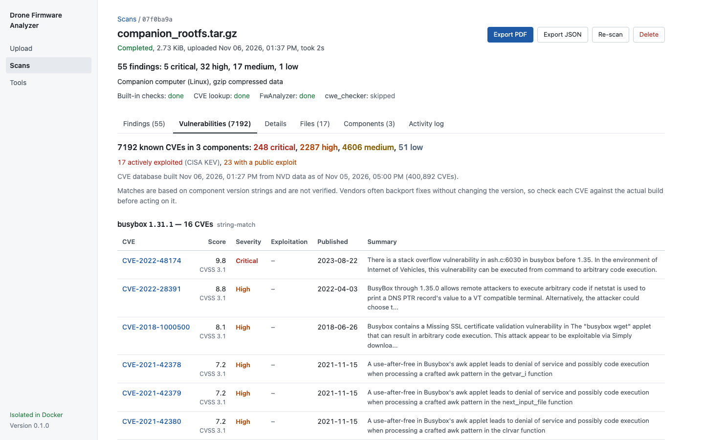

<p align="center"></p>

# Drone Firmware Analyzer

Upload drone firmware and get a static security report. Built for PX4 and
ArduPilot flight-controller firmware and Linux companion-computer images.
Firmware is never executed.


## What it does

* **Identifies** the format from content (ELF, zip/tar/gzip/xz, Intel HEX,
  `.px4`, `.apj`, DfuSe, uImage, cpio, ROMFS, SquashFS, ext2/3/4, FAT,
  UBI/JFFS2, MBR/GPT disk images, raw Cortex-M flash) and the platform,
  version, board and architecture. DJI and Parrot containers are recognised but
  not unpacked.
* **Extracts** recursively inside a network-less Docker sandbox, with
  path-traversal, symlink and decompression-bomb protection.
* **Scans** for hardcoded credentials and keys, insecure services and
  configs, PX4/ArduPilot safety parameters, MAVLink exposure, ELF hardening and
  outdated components.
* **Looks up CVEs** for each identified component and the PX4/ArduPilot
  version, in a local database built from NVD, CISA KEV and Exploit-DB.
* **Runs FwAnalyzer** (Linux filesystem policy) and **cwe_checker**
  (Ghidra-based binary analysis) when they apply.
* **Reports** every tool's results in one format, with JSON and PDF export,
  history, re-scan and release comparison.

Each finding is `detected` (concrete evidence), `suspicious` (heuristic),
`unverified` (needs confirmation, such as version-based CVE matches and
cwe_checker warnings) or `info`. Nothing is called a confirmed vulnerability,
and every scan shows which tools were missing, not applicable or failed.

## Quick start

Needs Python 3.11+, Node 20+ and Docker.

```bash
make install         # venv + backend and frontend dependencies
make sandbox-image   # sandbox image dfa-sandbox:latest (includes FwAnalyzer)
make cve-db          # CVE database from NVD, CISA KEV, Exploit-DB (~400 MB)
make run             # API + worker + UI on http://127.0.0.1:8000
```

Optional:

```bash
docker pull ghcr.io/fkie-cad/cwe_checker:stable   # cwe_checker (Apple Silicon: see below)
make fixtures                                     # synthetic test firmware in fixtures/generated/
make dev-api                                      # with `make dev-ui`: hot reload, UI on :5173
```

* **Docker must be running** (on macOS, open Docker Desktop). Otherwise
  FwAnalyzer and cwe_checker show as unavailable, and scans run in a weaker
  fallback without a container, with a warning banner.
* `make install` uses the `python3` on your `PATH`. The one that ships with
  macOS is too old: `brew install python@3.12`.
* **Apple Silicon:** cwe_checker's `:stable` image has no arm64 build. Pull
  `:latest` instead and add
  `DFA_CWE_CHECKER_IMAGE=ghcr.io/fkie-cad/cwe_checker:latest` to
  `backend/.env`.
* `backend/.env` is gitignored, so recreate it on a new machine.
* Re-run `make cve-db` to refresh CVE data. The scan page warns after 30 days.

**Docker Compose:** `docker compose up --build`, then
`docker compose run --rm api python -m dfa.cve update` to build the CVE
database. Data lives in `./var`. The worker uses the host's Docker socket to
start a sandbox per scan, so read [docs/SECURITY.md](docs/SECURITY.md) before
exposing it.

## Using it

| Page | What's there |
|---|---|
| **Upload** | Drag in one or more firmware files. Recent scans are listed below. |
| **Scans** | Searchable history. Select two completed scans to compare them. |
| **Scan** | Finding counts and each tool's status, then tabs: **Findings**, **Vulnerabilities** (CVE matches with actively-exploited and public-exploit flags), **Details** (identification and risk score), **Files** (extracted inventory), **Components** and **Activity log**. Export PDF or JSON, re-scan or delete. |
| **Compare** | New, resolved and changed findings, and component version changes, between two releases. |
| **Tools** | Whether each analysis tool is available, and how to enable it. |



## Configuration

Settings are `DFA_*` environment variables, also read from `backend/.env`.
Restart the app after changing them. The most common:

| Variable | Default | Meaning |
|---|---|---|
| `DFA_MAX_UPLOAD_MB` | 512 | Upload limit |
| `DFA_API_KEY` | – | Require this key in an `X-API-Key` header |
| `DFA_SANDBOX_MODE` | `auto` | `docker`, `local` or `auto` |
| `DFA_CWE_CHECKER_IMAGE` | `ghcr.io/fkie-cad/cwe_checker:stable` | cwe_checker image |
| `DFA_KEEP_EXTRACTED` | `true` | `false` deletes extracted files after each scan |

All settings, and the limits needed for multi-GB images, are in
[docs/CONFIGURATION.md](docs/CONFIGURATION.md).

## API

OpenAPI docs are at `/api/docs`. Upload with `POST /api/scans` (multipart
`file`), poll `GET /api/scans/{id}`, then fetch `/findings`, `/report.json` or
`/report.pdf`. The full list is in [docs/ARCHITECTURE.md](docs/ARCHITECTURE.md#api).

## Tests

```bash
make test   # backend pytest, frontend vitest and type-check
make lint
```

Tests generate synthetic firmware at runtime; no proprietary firmware is
included. Tests that need Docker are skipped when `dfa-sandbox:latest` is
missing.

## Limitations

* Static only: firmware is never run or emulated.
* CVE matches are version-based, so backported fixes aren't detected and
  every match is `unverified`. Software without an identifiable version isn't
  matched, and Linux kernel counts run high because kernel configuration isn't
  considered.
* PX4/ArduPilot firmware gets identification, embedded files, strings and CVE
  lookup only. cwe_checker's bare-metal mode for it is experimental and off by
  default.
* cwe_checker is slow (about 25 s for a 70 KB binary, 9 min for BusyBox, which
  is therefore skipped) and checks at most 5 binaries per scan.
* Not unpacked: LZ4/LZO/zstd, 7z/RAR, encrypted vendor containers (such as
  DJI) and Android sparse images. These are reported as not fully analysed.
  UBI/UBIFS and JFFS2 only unpack inside the Docker sandbox.
* Single node (SQLite, local files) with one shared API key. Not hardened for
  internet exposure.

More: [tool notes](docs/TOOLS.md) · [architecture](docs/ARCHITECTURE.md) ·
[security model](docs/SECURITY.md)
