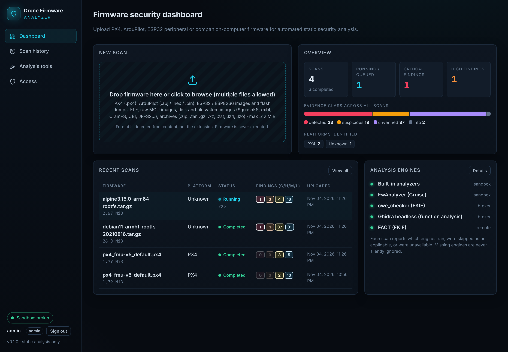
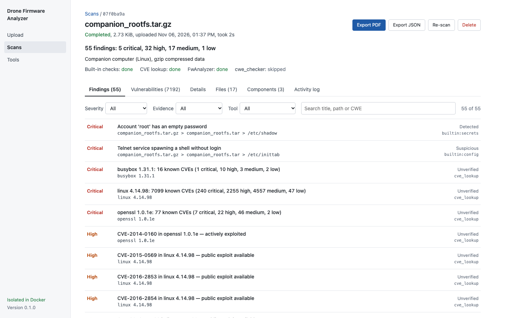

# Drone Firmware Analyzer

Upload drone firmware and get an automated **static** security analysis report. PX4 and ArduPilot
flight-controller firmware, Linux companion-computer images and Espressif (ESP32/ESP8266) peripheral
firmware are first-class targets; format, platform and tool registries are designed for extension.



## What it does

| Stage | Details |
|---|---|
| **Upload** | Drag-and-drop UI or `POST /api/scans`. Authenticated, size-limited (checked before the multipart body is spooled), rate-limited per user, hashed (SHA-256), stored read-only. Firmware is **never executed**. |
| **Identification** | Content-based format detection (extensions are ignored); platform (PX4, ArduPilot, Betaflight, INAV, Espressif, Linux companion; DJI `IM*H` and Parrot `PLF` containers), version, vehicle type, board ID; architecture from ELF headers, Cortex-M vector tables, ESP image headers or — for headerless code — opcode-signature voting (ARM, Thumb-2, AArch64, MIPS BE/LE, PowerPC, x86/x86-64, Xtensa, RISC-V). |
| **Extraction** | Recursive, in a network-less container, with traversal/link/device protection and size/count/depth/ratio budgets. ZIP, tar, gzip, bzip2, xz, LZMA, **Zstandard, LZ4 (frame + legacy), lzop/LZO**, cpio, ROMFS, **NuttX CROMFS (PX4 `/etc`)**, SquashFS, ext2/3/4, FAT, **CramFS**, UBI/UBIFS, JFFS2, EROFS (identified), **Android sparse**, MBR/GPT, U-Boot uImage, Intel HEX, DfuSe, PX4 `.px4`, ArduPilot `.apj`, **ESP application images and ESP flash dumps (partition table)**, **Parrot PLF**, **DJI IM\*H plaintext chunks** (encrypted chunks are reported, never decrypted). Carving of embedded filesystems/streams from raw images. |
| **Built-in scanners** | Credentials, keys and tokens; `/etc/shadow`; insecure services; PX4 circuit breakers / ArduPilot safety parameters; MAVLink exposure; ELF hardening and dangerous imports; component version strings; **package inventories** (dpkg, apk, opkg, Python) with file ownership. |
| **External engines** | **FwAnalyzer** (in the sandbox; Linux and NuttX rule profiles), **cwe_checker** (ELF and bare-metal Cortex-M), **Ghidra headless** (function recovery, call-site analysis), **FACT** (REST). Every engine reports `completed / failed / skipped (not applicable) / unavailable / timeout` per scan. |
| **Vulnerability intelligence** | Offline OSV database (Debian, Alpine, upstream GIT ranges; NVD CVE data via OSV): **backport-aware** matching of installed distro packages; release-tag matching for upstream components (OpenSSL, BusyBox, glibc, PX4, NuttX, ArduPilot by vehicle, ESP-IDF, FreeRTOS, Zephyr, …); CVSS v3 base scores. |
| **Normalisation** | One finding schema for all engines (severity, classification, confidence, evidence, component, owning package, CWE, remediation); cross-tool correlation, aggregation of per-file repeats, deduplication. |
| **Reporting** | Live dashboard (pipeline, findings with evidence basis, inventory, packages with advisories, components, activity log), **PDF**, **JSON**, **SARIF 2.1.0**, **CycloneDX 1.5 SBOM**, scan history, re-scan, release comparison. |

### Honest findings

Every finding carries a **classification** and the UI states its **basis**:

| Classification | Meaning | Typical basis |
|---|---|---|
| `detected` | Concrete evidence present (key file, `root::` in shadow, installed package listed in a distro advisory). Exploitability is **not** verified. | Direct evidence · Distribution security advisory |
| `suspicious` | Heuristic/pattern match; may be a false positive. | Heuristic pattern |
| `unverified` | Needs manual confirmation. | Static-analysis warning (cwe_checker, Ghidra) · Version-based match |
| `info` | Context. | |

Nothing is labelled a "confirmed vulnerability". Static-analysis warnings and version matches are
never promoted to `detected`. Tools that are missing, not configured, not applicable or failing are
shown as such on every scan.



## Quick start (development)

Requirements: Python ≥ 3.11, Node ≥ 20, Docker (recommended).

```bash
make install              # venv + backend deps + frontend deps
```

```bash
make sandbox-image        # builds dfa-sandbox:latest (unpackers + FwAnalyzer)
```

```bash
docker pull fkiecad/cwe_checker:latest   # cwe_checker 0.9 + Ghidra 11.2.1 (also used for the Ghidra layer)
```

Build the offline vulnerability database (downloads the public OSV dumps for Debian, Alpine and upstream GIT ranges, ~300 MB; or pass
`--source-dir` with already downloaded `<Ecosystem>.zip` files):

```bash
cd backend && ../.venv/bin/python -m dfa.vulndb update --download
```

Run API + worker + UI on http://127.0.0.1:8000 (create the first admin on start-up):

```bash
DFA_BOOTSTRAP_ADMIN=admin DFA_BOOTSTRAP_ADMIN_PASSWORD='choose-a-long-password' make run
```

To keep Docker access out of the API/worker process, start the sandbox broker in another shell
(as a user that may use Docker) and point the app at it:

```bash
make broker
```

```bash
DFA_SANDBOX_MODE=broker DFA_BROKER_SOCKET=$PWD/backend/var/broker.sock DFA_BOOTSTRAP_ADMIN=admin DFA_BOOTSTRAP_ADMIN_PASSWORD='choose-a-long-password' make run
```

Further users: `python -m dfa.cli create-user <name> --role analyst|viewer|admin` or the **Access**
page. Without Docker the app uses a **local rlimit-only fallback** and shows a warning banner
(`DFA_ALLOW_UNSANDBOXED=false` refuses scans instead).

### Docker Compose (single node)

```bash
make sandbox-image
```

```bash
mkdir -p var && sudo chown 10002:10002 var
```

```bash
DFA_BOOTSTRAP_ADMIN_PASSWORD='choose-a-long-password' docker compose up --build
```

Only the **broker** service can reach the Docker daemon. The API and worker run as an unprivileged
user without a Docker client or socket and request one of four fixed job profiles over a Unix socket
(see [docs/SECURITY.md](docs/SECURITY.md)). FACT is deployed separately: set `DFA_FACT_URL`.

## Configuration

Environment variables (prefix `DFA_`, also read from `backend/.env`). Main ones:

| Variable | Default | Meaning |
|---|---|---|
| `DFA_DATA_DIR` | `backend/var` | Uploads, work directories, SQLite DB, vulnerability DB |
| `DFA_MAX_UPLOAD_MB` | 512 | Upload limit (HTTP 413, enforced before the body is read) |
| `DFA_BOOTSTRAP_ADMIN` / `_PASSWORD` | – | First administrator, created when no user exists |
| `DFA_SESSION_COOKIE_SECURE` | `false` | Set `true` behind HTTPS |
| `DFA_UPLOAD_RATE_PER_HOUR` / `DFA_MAX_ACTIVE_SCANS_PER_USER` / `DFA_MIN_FREE_DISK_MB` | 60 / 10 / 2048 | Upload abuse limits |
| `DFA_WORKER_MODE` / `DFA_WORKER_THREADS` | `inprocess` / 1 | `external` = run `python -m dfa.worker` separately |
| `DFA_SANDBOX_MODE` | `auto` | `broker`, `docker`, `local`, or `auto` |
| `DFA_BROKER_SOCKET` / `DFA_BROKER_TOKEN` | – | Use the sandbox broker (recommended); optional shared bearer token |
| `DFA_SANDBOX_IMAGE` / `_MEMORY` / `_CPUS` / `_PIDS` / `_TIMEOUT_S` | `dfa-sandbox:latest` / `2g` / `2` / 256 / 1800 | Sandbox container limits (broker side) |
| `DFA_SANDBOX_RUNTIME` | – | Alternative OCI runtime, e.g. `runsc` (gVisor) |
| `DFA_SANDBOX_MAX_JOBS` / `DFA_MAX_WORK_DIR_MB` | 2 / 8192 | Concurrent containers; per-scan disk cap (container killed above it) |
| `DFA_SANDBOX_HOST_DATA_DIR` / `DFA_GHIDRA_SCRIPTS_HOST_DIR` | – | Host paths when the broker itself runs in a container |
| `DFA_MAX_EXTRACT_TOTAL_MB` / `_FILE_MB` / `_FILES` / `_DEPTH` / `DFA_MAX_COMPRESSION_RATIO` | 2048 / 512 / 20000 / 5 / 250 | Extraction budgets (bomb protection) |
| `DFA_CWE_CHECKER_IMAGE` / `_MAX_BINARIES` / `_TIMEOUT_S` / `_MEMORY` / `_BARE_METAL` | `fkiecad/cwe_checker:latest` / 3 / 3600 / `4g` / `true` | cwe_checker |
| `DFA_GHIDRA_ENABLED` / `_IMAGE` / `_MAX_BINARIES` / `_TIMEOUT_S` / `_MEMORY` | `true` / cwe_checker image / 3 / 1800 / `6g` | Ghidra headless layer |
| `DFA_FWANALYZER_ENABLED` / `_TIMEOUT_S` | `true` / 600 | FwAnalyzer |
| `DFA_FACT_URL` / `_API_KEY` / `_TIMEOUT_S` / `_POLL_S` | – / – / 3600 / 15 | FACT REST service |
| `DFA_VULNDB_PATH` | `<data>/vulndb.sqlite` | Offline OSV database |
| `DFA_KEEP_EXTRACTED` | `true` | `false` deletes extracted files after each scan |

## API

OpenAPI docs at `/api/docs`. Session cookie (`POST /api/auth/login`) with a CSRF header
(`X-DFA-CSRF: 1`) for state-changing requests, or `Authorization: Bearer <token>` (API tokens from
`POST /api/auth/tokens`). Roles: `viewer` (read), `analyst` (upload, manage own scans), `admin`.

* `POST /api/scans` (multipart `file`) → scan (queued); `GET /api/scans?q=&status=&limit=&offset=`
* `GET /api/scans/{id}` – status, progress, identification, tool runs, events
* `GET /api/scans/{id}/findings?severity=&classification=&tool=&q=`, `/artifacts`, `/packages?vulnerable=&q=`
* `GET /api/scans/{id}/report.json | report.pdf | report.sarif | sbom.cdx.json`
* `POST /api/scans/{id}/rescan`, `DELETE /api/scans/{id}`, `GET /api/compare?base=&target=`
* `GET /api/tools`, `/api/stats`, `/api/config`, `/api/health`; users and tokens under `/api/users`, `/api/auth/tokens`

## Architecture

```
frontend/ (React + TS)            backend/dfa/
  dashboard, scans, compare,        main.py       FastAPI: auth, upload limits, reports, UI
  tools, access                     auth.py       users, roles, scrypt, session/API tokens, CSRF
          │ /api                    worker.py     SQLite job queue (atomic claim, stale recovery)
          ▼                         pipeline.py   sandbox → OSV → engines → attribute → correlate → persist
  API + worker (uid 10002,          broker.py     the ONLY Docker client: fixed job profiles over a Unix socket
  no Docker access)                 containers.py job profiles, argv validation, hardened `docker run`
          │ Unix socket             core/         ← the only code that parses firmware bytes (runs in the sandbox)
          ▼                           identify.py, extract.py, formats/, scanners/, analyze.py
  broker ──► docker run --network none --read-only --cap-drop ALL …
               dfa-sandbox (identify/extract/scan, FwAnalyzer) · cwe_checker · Ghidra headless
  FACT (separate deployment, REST)  vulndb.py / vulnmatch.py  offline OSV database + matching
                                    reports/      JSON, PDF, SARIF, CycloneDX
```

**Adding a platform:** append a `PlatformSignature` in `core/identify.py` and, if needed, a scanner
in `core/scanners/`. **Adding a format:** a detector in `identify.py` and a handler in `extract.py`.
**Adding a tool:** subclass `ToolAdapter` (`status`, `plan`, `run`), register it in
`adapters/registry.py`; container tools also need a job profile in `containers.py`.

## Tests

```bash
make test     # backend pytest + frontend vitest + type-check
```

```bash
make lint
```

* **Unit / integration** (always): synthetic fixtures generated at runtime
  (`backend/tests/factory.py`), including malicious archives (zip-slip, tar traversal/links/devices,
  bombs, nested archives, ext duplicate-entry attack, CROMFS loops). Mocks are used for unit tests
  of tool adapters only.
* **Real samples** — fetch the pinned public samples first (PX4 v1.17.0 builds, ArduPilot
  bootloaders, esptool's ESP images; SHA-256 verified):

  ```bash
  python scripts/fetch_real_firmware.py
  ```

  `tests/test_formats_real.py` and the **regression suite** `tests/test_regression_real.py`
  (compares each sample's analysis signature with `fixtures/regression/baseline.json`; regenerate
  with `scripts/update_regression_baseline.py` after intentional changes and review the diff).
  The Debian 11 armhf / Alpine 3.15 arm64 root filesystems used by some tests are exports of the
  official Docker Hub images (tests skip when they are absent):

  ```bash
  cd fixtures/real && cid=$(docker create --platform linux/arm/v7 debian:bullseye-20210816-slim) && docker export $cid | gzip -1 > debian11-armhf-rootfs-20210816.tar.gz && docker rm $cid
  ```

  ```bash
  cd fixtures/real && cid=$(docker create --platform linux/arm64 alpine:3.15.0) && docker export $cid | gzip -1 > alpine3.15.0-arm64-rootfs.tar.gz && docker rm $cid
  ```
* **Real tools** (opt-in, minutes): runs the actual FwAnalyzer, cwe_checker, Ghidra and FACT:

  ```bash
  cd backend && DFA_REAL_TOOLS=1 DFA_FACT_URL=http://localhost:5000 ../.venv/bin/pytest tests/test_real_tools.py
  ```

## Validation status and limitations

See [docs/TOOLS.md](docs/TOOLS.md) for per-tool evidence and [docs/SECURITY.md](docs/SECURITY.md)
for the isolation model. In short:

* **Verified with real inputs:** PX4 v1.17.0 `.px4`/ELF identification and extraction (incl. CROMFS),
  ArduPilot bootloader identification, cwe_checker on ARM/AArch64 ELFs and bare-metal PX4 and
  ArduPilot images, Ghidra function recovery on ELFs and Cortex-M images, FACT end to end over REST,
  FwAnalyzer on Debian/Alpine root filesystems and PX4 CROMFS, OSV matching on real Debian/Alpine
  package databases, ESP image/partition parsing, the broker-only compose topology with an
  unprivileged worker.
* **ArduPilot:** validated on the official **bootloader** builds committed in the ArduPilot repository
  (AP_Bootloader for fmuv3, Matek H743, Pixhawk 6X, CubeOrange; `.bin` and `.hex`). Real
  *flight-stack* builds (`.apj`) could not be obtained: `firmware.ardupilot.org` was unreachable from
  the development environment and building ArduPilot from source there was not permitted, so
  vehicle-firmware identification (`.apj`, app descriptor, vehicle/version strings) is covered by
  synthetic samples only.
* **cwe_checker** panics on the unstripped PX4 debug ELF (upstream issue; reported verbatim) and
  bare-metal mode is experimental upstream; a 2 MB PX4 image takes ~20 minutes.
* **FACT** cannot unpack `.px4` containers or raw MCU images; for such inputs it completes without
  plug-in results, and the tool run says so.
* **FwAnalyzer** permission checks are disabled in directory mode (extracted trees normalise modes;
  setuid/world-writable bits are checked by the built-in scanner from archive metadata instead).
* **DJI / Parrot:** container headers are parsed from public community documentation; encrypted DJI
  modules are reported, never decrypted. No real vendor samples were used.
* **gVisor / rootless Docker:** supported by configuration (`DFA_SANDBOX_RUNTIME`, a rootless daemon
  socket for the broker) but not verified in the development environment.
* Single-node design (SQLite, local storage).

## Project layout

```
backend/        FastAPI app, analysis core, adapters, broker, tests
frontend/       React + TypeScript dashboard
docker/         sandbox and app/broker images
docs/           tool research and validation, security model, screenshots
fixtures/       regression baseline (real samples are fetched, not committed)
scripts/        sample fetcher, regression baseline generator, fixture generator
```
