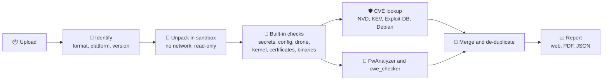

<p align="center">
  
</p>

<h1 align="center">Rotorscope</h1>

<p align="center">
  <b>Night vision for drone firmware.</b><br>
  Drop in PX4, ArduPilot or companion-computer firmware and get a security report:<br>
  leaked keys, risky configs, exposed MAVLink links and known CVEs. The firmware is never run.
</p>

<p align="center">
  <a href="https://github.com/Allghelierce/df-combine/actions/workflows/ci.yml"></a>
  
  
  
  
  
</p>

<p align="center">
  <a href="#-quick-start">Quick start</a> ·
  <a href="#-what-it-finds">What it finds</a> ·
  <a href="#-how-it-works">How it works</a> ·
  <a href="#%EF%B8%8F-limitations">Limitations</a> ·
  <a href="#-docs">Docs</a>
</p>


## 🦉 Why Rotorscope

- **Built for drones.** It understands PX4 `.px4`, ArduPilot `.apj`/`.hex`,
  Betaflight and INAV, MAVLink and flight-controller safety parameters, as
  well as the Linux images that run on companion computers.
- **Safe to point at anything.** Every file is unpacked inside a network-less
  Docker sandbox, with protection against path traversal, symlink tricks and
  decompression bombs. Firmware is never executed.
- **Honest about certainty.** Every finding says whether it is hard evidence or
  a lead to check. Nothing is called a confirmed vulnerability.
- **Offline CVE lookups.** About 400,000 CVEs live in a local database on your
  machine. Nothing about your firmware is sent anywhere.
- **Quick.** Small images take seconds and large Linux images take minutes.
  cwe_checker, when enabled, is the slow part.

## 🔍 What it finds

| | Check | Examples |
|---|---|---|
| 🔑 | **Secrets** | Empty root passwords, SSH host and private keys, Wi-Fi passphrases, API tokens |
| ⚙️ | **Insecure configuration** | Telnet shells without login, root SSH login, autologin, open access points |
| 🚁 | **Drone safety** | Disabled PX4 circuit breakers, ArduPilot safety parameters, MAVLink exposed to the network (mavlink-router, MAVProxy) |
| 🛡️ | **Known vulnerabilities** | CVEs for every identified component and the PX4/ArduPilot version, flagged when **actively exploited** (CISA KEV) or when **public exploit code** exists (Exploit-DB) |
| 🐧 | **Kernel hardening** | 34 options the Kernel Self Protection Project recommends, such as `STRICT_KERNEL_RWX`, `STACKPROTECTOR_STRONG`, `MODULE_SIG` and `STRICT_DEVMEM`, read from `/boot/config-*`, module configs or the kernel's embedded config |
| 📜 | **Certificates** | Expired or not-yet-valid certificates, weak RSA/DSA/EC keys, MD5/SHA-1 signatures, self-signed leaf certificates, very long validity |
| 🧱 | **Binary hardening** | Programs without NX, PIE, RELRO or stack canaries, and dangerous calls such as `gets` |
| 🔬 | **Deep analysis** | [cwe_checker](https://github.com/fkie-cad/cwe_checker) (Ghidra-based) on up to 15 binaries, vendor binaries first, plus the [FwAnalyzer](https://github.com/cruise-automation/fwanalyzer) filesystem policy |

> [!TIP]
> **Fewer false alarms on Debian-based images.** For Raspberry Pi OS or
> Debian, each package is checked against Debian's own list of fixed versions,
> so fixes Debian backported don't show up as open CVEs. Kernel CVEs in drivers,
> filesystems or CPU architectures the image's kernel doesn't include are
> labelled as unlikely to apply.


## 🧭 How it works



Every finding carries a label that says how much to trust it:

| Label | Meaning |
|---|---|
| `detected` | Concrete evidence in the image, such as `root::` in `/etc/shadow` |
| `suspicious` | A pattern match that may be a false alarm |
| `unverified` | Needs a human to confirm. This covers every CVE match and every cwe_checker warning |
| `info` | Context, not a weakness on its own |

Every scan also lists which tools were missing, not applicable or failed, so
nothing is skipped silently.

## 🚀 Quick start

Needs Python 3.11+, Node 20+ and Docker (running).

```bash
make install         # Python venv + backend and frontend dependencies
make sandbox-image   # sandbox image dfa-sandbox:latest (includes FwAnalyzer)
make cve-db          # local CVE database: NVD, CISA KEV, Exploit-DB, Debian tracker (~460 MB)
make run             # API + worker + UI on http://127.0.0.1:8000
```

Then open **http://127.0.0.1:8000** and drag in a firmware file. If you don't
have one, `make fixtures` generates synthetic test firmware in
`fixtures/generated/`.

> [!IMPORTANT]
> **Updating an existing install?** After pulling, re-run `make install` and
> `make sandbox-image` (there's a new `cryptography` dependency) and
> `make cve-db` (to get the Debian tracker data).

<details>
<summary><b>Setup notes:</b> macOS, Apple Silicon, cwe_checker, Docker Compose</summary>

* **Docker must be running** (on macOS, open Docker Desktop). Otherwise
  FwAnalyzer and cwe_checker show as unavailable, and scans run in a weaker
  fallback without a container, with a warning banner.
* `make install` uses the `python3` on your `PATH`. The one that ships with
  macOS is too old, so run `brew install python@3.12`.
* **cwe_checker:** `docker pull ghcr.io/fkie-cad/cwe_checker:stable`. On
  **Apple Silicon**, `:stable` has no arm64 build. Pull `:latest` instead and
  add `DFA_CWE_CHECKER_IMAGE=ghcr.io/fkie-cad/cwe_checker:latest` to
  `backend/.env`.
* `backend/.env` is gitignored, so recreate it on a new machine.
* Re-run `make cve-db` to refresh CVE data. The scan page warns after 30 days.
* **Hot reload:** `make dev-api` together with `make dev-ui` (UI on `:5173`).
* **Docker Compose:** run `docker compose up --build`, then
  `docker compose run --rm api python -m dfa.cve update` to build the CVE
  database. Data lives in `./var`. The worker uses the host's Docker socket to
  start a sandbox per scan, so read [docs/SECURITY.md](docs/SECURITY.md)
  before exposing it.

</details>

## 🖥️ Using it

| Page | What's there |
|---|---|
| **Upload** | Drag in one or more firmware files. Recent scans are listed below. |
| **Scans** | Searchable history. Select two completed scans to compare them. |
| **Scan** | Finding counts and each tool's status, then tabs: **Findings**, **Vulnerabilities** (CVE matches with actively-exploited and public-exploit flags), **Details** (identification and risk score), **Files** (extracted inventory), **Components** and **Activity log**. Export PDF or JSON, re-scan or delete. |
| **Compare** | New, resolved and changed findings, and component version changes, between two releases. |
| **Tools** | Whether each analysis tool is available, and how to enable it. |

## ⚙️ Configuration

Settings are `DFA_*` environment variables, also read from `backend/.env`.
Restart the app after changing them. The most common:

| Variable | Default | Meaning |
|---|---|---|
| `DFA_MAX_UPLOAD_MB` | 512 | Upload limit |
| `DFA_API_KEY` | – | Require this key in an `X-API-Key` header |
| `DFA_SANDBOX_MODE` | `auto` | `docker`, `local` or `auto` |
| `DFA_CWE_CHECKER_IMAGE` | `ghcr.io/fkie-cad/cwe_checker:stable` | cwe_checker image |
| `DFA_KEEP_EXTRACTED` | `true` | `false` deletes extracted files after each scan |

A full Raspberry Pi OS or Debian root filesystem (about 100,000 files) is
analysed completely by default. Multi-GB disk images need the raised limits in
[docs/CONFIGURATION.md](docs/CONFIGURATION.md#large-images), which also lists
every setting.

## 🔌 API

OpenAPI docs are at `/api/docs`. Upload with `POST /api/scans` (multipart
`file`), poll `GET /api/scans/{id}`, then fetch `/findings`, `/report.json` or
`/report.pdf`. The full list is in [docs/ARCHITECTURE.md](docs/ARCHITECTURE.md#api).

## 🧪 Tests

```bash
make test   # backend pytest, frontend vitest and type-check
make lint
```

Tests generate synthetic firmware at runtime, and no proprietary firmware is
included. Tests that need Docker are skipped when `dfa-sandbox:latest` is
missing.

## ⚠️ Limitations

* **Static only.** Firmware is never run or emulated.
* **CVE matches are version-based**, and every match is `unverified`. Debian
  packages are checked against Debian's fixed versions. Ubuntu and other
  distributions, and software outside the package manager, are matched on
  upstream versions, so their backported fixes aren't detected. Software
  without an identifiable version isn't matched.
* **Kernel CVE filtering is a heuristic.** CVEs are filtered by architecture
  and by whether the named driver or filesystem exists in the image's kernel
  modules. The filter uses the CVE's subsystem name, not the patched files, so
  core-kernel counts still run high.
* **Certificates are judged at scan time.** A certificate that is valid today
  but expires next month isn't flagged.
* **Flight-controller firmware** (PX4/ArduPilot) gets identification, embedded
  files, strings and CVE lookup only. cwe_checker's bare-metal mode for it is
  experimental and off by default.
* **cwe_checker is slow**: about 25 s for a 70 KB binary, and 9 minutes for
  BusyBox, which is therefore skipped. It checks 15 binaries per scan by
  default, vendor binaries that no package owns first.
  `DFA_CWE_CHECKER_MAX_BINARIES=0` checks all of them.
* **Not unpacked:** LZ4/LZO/zstd, 7z/RAR, encrypted vendor containers (such as
  DJI) and Android sparse images. These are reported as not fully analysed.
  UBI/UBIFS and JFFS2 only unpack inside the Docker sandbox.
* **Single node** (SQLite, local files) with one shared API key. Not hardened
  for internet exposure.

## 📚 Docs

| | |
|---|---|
| [Tool notes](docs/TOOLS.md) | How FwAnalyzer, cwe_checker and the CVE lookup are integrated, and what was verified |
| [Configuration](docs/CONFIGURATION.md) | Every setting, plus the limits for large images |
| [Architecture](docs/ARCHITECTURE.md) | Components, data flow and the full API |
| [Security model](docs/SECURITY.md) | What the sandbox protects against, and what it doesn't |

<sub>Rotorscope was previously called *Drone Firmware Analyzer*. The code still
uses its short name `dfa`: the `dfa` Python package, the `DFA_*` settings and
the `dfa-sandbox` image.</sub>

<p align="center"><sub>🦉 Keeps watch over your firmware, so you find the bugs before anyone else does.</sub></p>
